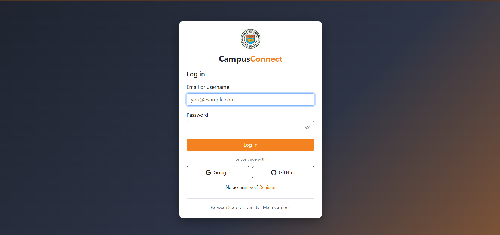
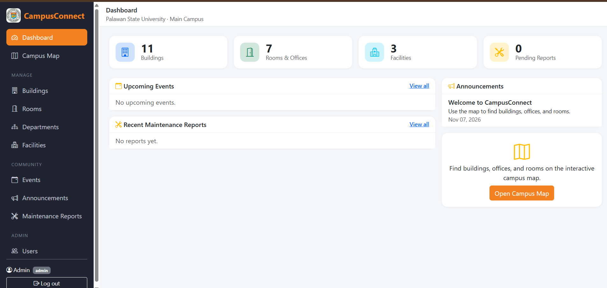
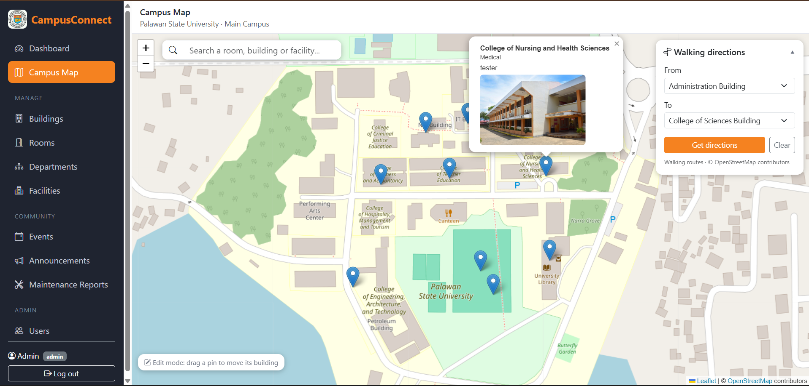
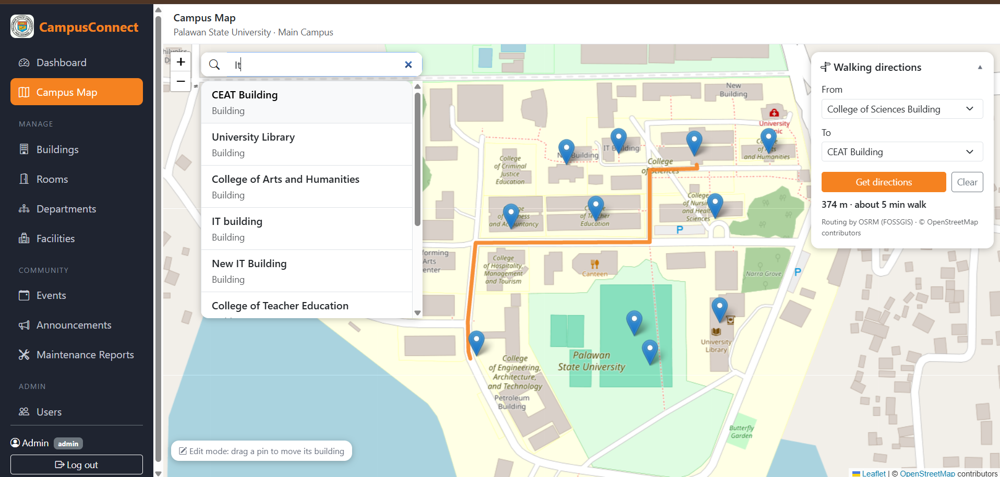
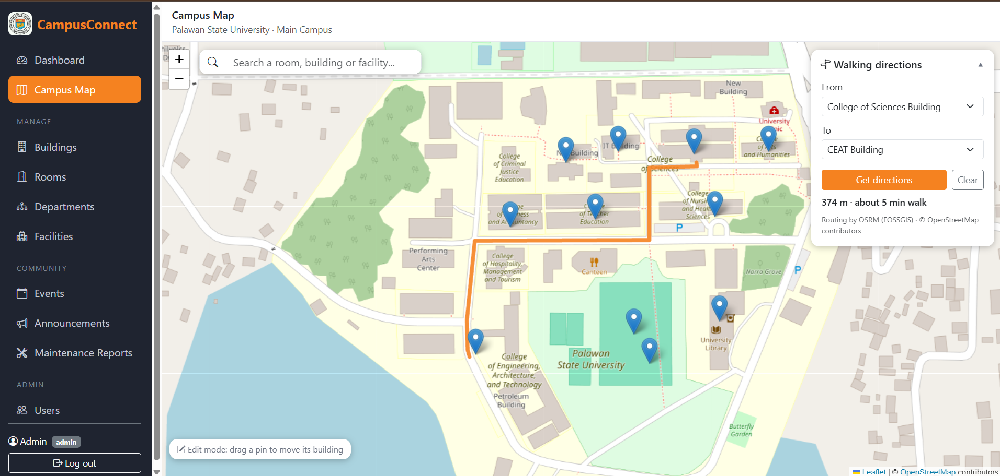
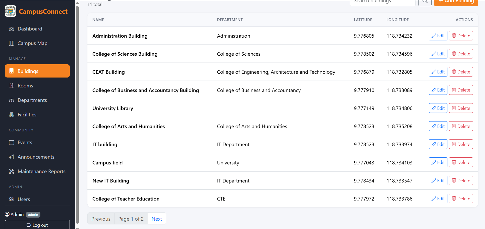
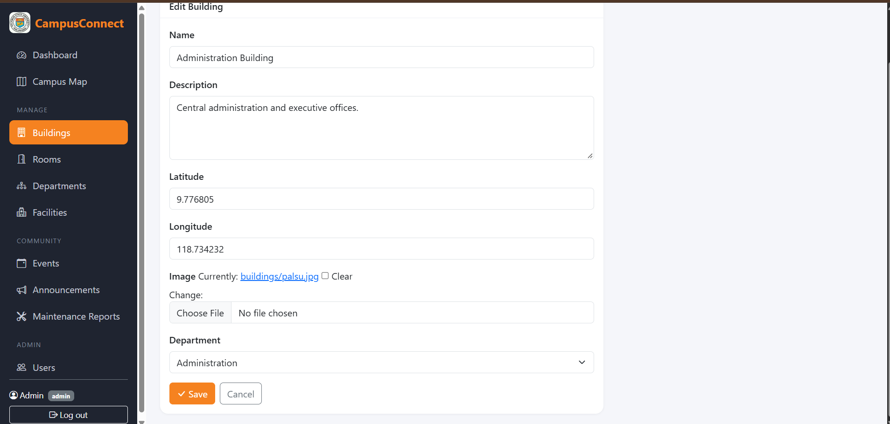
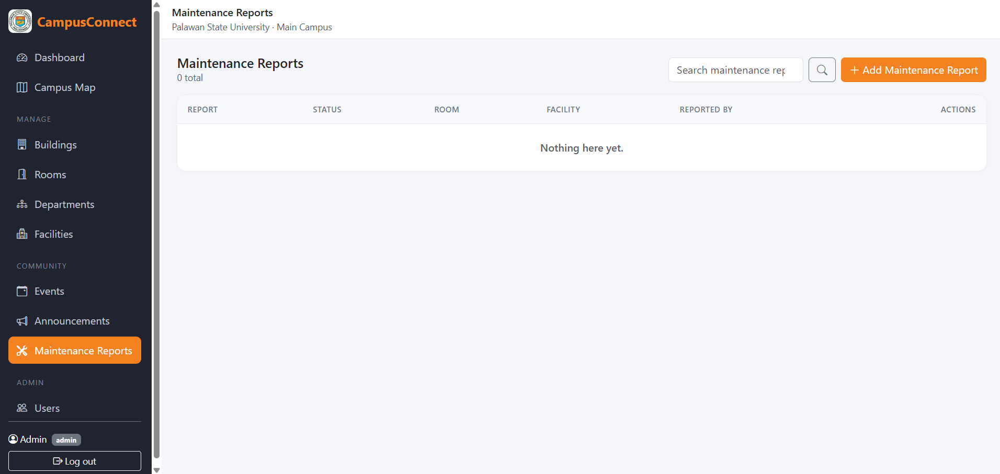
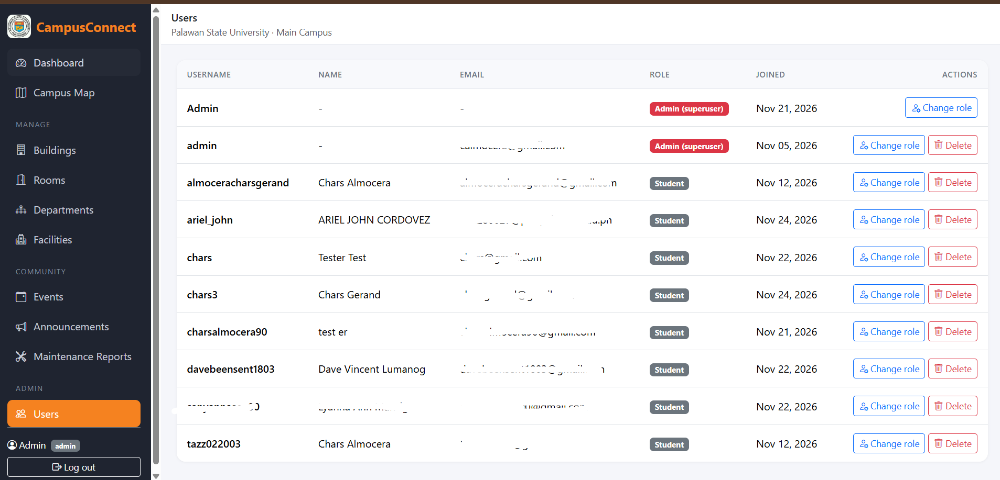
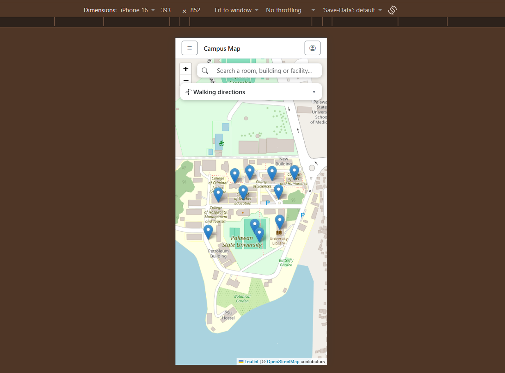

# CampusConnect

**Campus Mapping and Facility Management System for Palawan State University – Main Campus**

CampusConnect is a web system where students can find school buildings, offices, laboratories, and facilities on an interactive campus map. It also helps the school keep track of events, announcements, and maintenance reports in one place, with different access for students, staff, and admins.

## Features

- Interactive campus map with a marker for every building
- Search for a room, office, building, or facility and jump straight to its location on the map
- Walking directions between two buildings, with distance and estimated walking time
- Dashboard with campus statistics, upcoming events, announcements, and recent maintenance reports
- Add, view, edit, and delete records for departments, buildings, rooms, facilities, events, announcements, and maintenance reports
- Maintenance report tracking (pending, ongoing, done)
- Sign in with email, Google, or GitHub
- Role-based access for students, staff, and admins, plus a user management page for admins
- REST API for all campus data
- Responsive design that works on phones, tablets, and laptops

## Screenshots

| Login | Dashboard |
|---|---|
|  |  |

| Campus Map | Search |
|---|---|
|  |  |

| Walking Directions | Buildings (CRUD) |
|---|---|
|  |  |

| Add / Edit Form | Maintenance Reports |
|---|---|
|  |  |

| User Roles | Mobile View |
|---|---|
|  |  |

## Tech Stack

- **Backend:** Python, Django, Django REST Framework
- **Database:** SQLite
- **Frontend:** HTML, CSS, JavaScript, Bootstrap 5, Bootstrap Icons
- **Map:** Leaflet.js with OpenStreetMap
- **External API:** OSRM walking-route service (hosted by FOSSGIS, based on OpenStreetMap data)
- **Authentication:** Django authentication with django-allauth (Google and GitHub OAuth)
- **Hosting:** PythonAnywhere
- **Tools:** Git and GitHub

## Links

- Live system: https://campusconnect.pythonanywhere.com
- Source code: https://github.com/Tazz022003/campusconnect

## Credits

- [Your Full Name](https://github.com/Tazz022003)
- [Groupmate Full Name](https://github.com/their-username)

Map data &copy; OpenStreetMap contributors. Walking routes by OSRM (FOSSGIS).